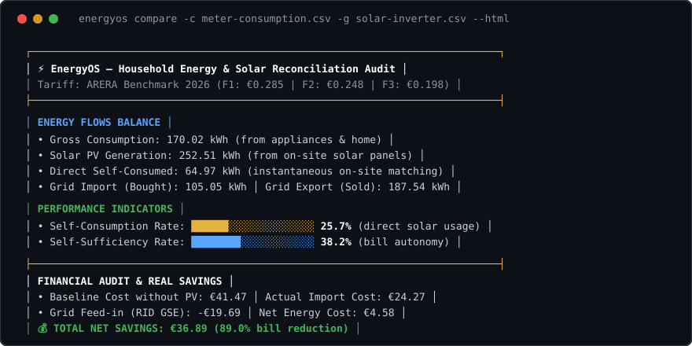

# EnergyOS

[](https://github.com/MRJonam91/EnergyOS/actions/workflows/ci.yml)
[](LICENSE)
[](package.json)
[](https://github.com/sponsors/MRJonam91)

**Italiano** | [English](README.md)

> **Riconciliazione consumi da contatore smart e produzione da fotovoltaico: calcola il tuo vero autoconsumo, la dipendenza dalla rete e il risparmio reale per fascia oraria ARERA (F1, F2, F3).**



---

## ⚡ Il Problema

Le bollette elettriche riportano solo i totali aggregati mensili e i costi complessivi. Le app degli inverter fotovoltaici mostrano la produzione solare in modo isolato.

Metterli a confronto è finora stato un incubo:
1. Frequenze di campionamento disallineate (curve quartorarie dei contatori 2G vs flussi a 5 minuti degli inverter).
2. Tariffe multioraria ARERA (F1, F2, F3) con prezzi molto diversi tra ore di picco (giorni feriali), ore intermedie e festivi.
3. Impossibilità di capire quanto solare è stato **autoconsumato istantaneamente** e quanto è stato immesso in rete (Ritiro Dedicato / RID GSE), oscurando il vero rientro economico dell'impianto.

**EnergyOS** risolve tutto questo direttamente e privatamente sul tuo computer, con **zero dipendenze esterne**.

---

## 🚀 Avvio rapido​‌​​‌‌​‌​‌​‌​​‌​​‌​​‌​‌​​​‌‌‌​​‌​​‌‌​​​‌​​‌​‌‌​‌​‌‌​​‌​‌​‌‌​‌‌‌​​‌‌​​‌​‌​‌‌‌​​‌​​‌‌​​‌‌‌​‌‌‌‌​​‌​‌‌​‌‌‌‌​‌‌‌​​‌‌​​‌​‌‌​‌​​‌‌​​‌‌​‌‌​​​‌​​​‌‌‌​​‌​​‌‌​​​‌​‌‌​​​‌‌​​‌‌​‌​​

Esegui una simulazione realistica immediata di 7 giorni per un'abitazione con impianto fotovoltaico da 6 kWp, pompa di calore e tariffe ARERA:

```bash
npx energyos demo
```

Oppure genera un report HTML interattivo standalone:

```bash
npx energyos demo --html report-energetico.html
```

### Riconcilia i tuoi file CSV reali

```bash
# Confronta i file CSV separati di consumo e produzione fotovoltaica
npx energyos compare -c consumi-contatore.csv -g produzione-inverter.csv

# Simula un sistema di accumulo a batteria da 10 kWh (BSS)
npx energyos battery --capacity 10 -c consumi.csv -g fotovoltaico.csv

# Simula l'energia condivisa e gli incentivi di una Comunità Energetica (CER)
npx energyos cer -c consumi.csv -g fotovoltaico.csv

# Advisor di flessibilità: ottimizza pompa di calore e ricarica auto elettrica
npx energyos advisor -c consumi.csv -g fotovoltaico.csv

# Diagnostica pre-flight e verifica qualità del file CSV
npx energyos doctor consumi-contatore.csv

# Avvia il server locale di anteprima senza dipendenze
npx energyos serve --port 3000
```

---

## ✨ Funzionalità principali

- **⚡ Motore di allineamento temporale**: Ingestione dati da contatori 2G (e-distribuzione, Portale Consumi ARERA) e inverter solari, con riconoscimento automatico di separatori (`,`, `;`, `\t`) e formattazione numerica europea (`0,28` vs `0.28`).
- **🕒 Risoluzione fasce ARERA (F1 / F2 / F3)**: Mappatura accurata di F1 (ore di picco Lun-Ven 8-19), F2 (intermedie) e F3 (fuori picco, domeniche e tutte le festività nazionali italiane, inclusa la Pasquetta astronomica).
- **🔋 Simulatore di Accumulo Elettrochimico (BSS)**: Simula carica e scarica della batteria con limiti C-rate, soglie SoC, rendimento round-trip e curva di dimensionamento consigliato (*sweet spot*).
- **👥 Comunità Energetiche Rinnovabili (CER)**: Modella l'energia condivisa oraria su cabina primaria e stima il monte incentivi GSE (Tariffa Premio TIP + restituzione TIAC ARERA).
- **💡 Advisor Flessibilità Pompa di Calore & Auto EV**: Identifica le finestre di massimo surplus fotovoltaico per programmare scaldacqua in PDC (ACS) e colonnine wallbox.
- **🧾 Decomposizione Dettagliata Bolletta ARERA**: Spesa materia energia, commercializzazione fissa (PCV), quota potenza contatore (€/kW/mese), oneri ASOS/ARIM, franchigia accise residenti e IVA.
- **📊 Report HTML interattivo & Server Live**: Genera dashboard HTML offline (zero CDN) con grafici SVG della curva di carico, visualizzabili anche su `http://localhost:3000`.
- **🔒 Privacy assoluta e Local-First**: Nessun dato inviato a server terzi o cloud proprietari.
- **🌱 Architettura snella e verificabile**: L'intero modulo core è rigorosamente contenuto sotto le **1.500 righe di codice** con test nativi completi.

---

## 🏗️ Architettura

```
File CSV (Contatore & Solare) ──▶ Parser & Allineamento ──▶ Fasce ARERA ──▶ Riconciliazione ──▶ Terminale / HTML / JSON
```

Consulta [docs/ARCHITECTURE.md](docs/ARCHITECTURE.md) per i dettagli architetturali e i punti di estensione.

---

## ☕ Supporto & Donazioni

EnergyOS è un progetto open-source indipendente sviluppato e mantenuto da **Manoj Rollo (MRJonam91)**. Se questo strumento ti ha aiutato a capire i tuoi consumi, a risparmiare in bolletta o a dimensionare un sistema di accumulo a batterie, puoi supportarne lo sviluppo:

- **GitHub Sponsors:** [sponsor @MRJonam91](https://github.com/sponsors/MRJonam91)
- **Ko-fi:** [ko-fi.com/mrjonam](https://ko-fi.com/mrjonam)
- **Buy Me a Coffee:** [buymeacoffee.com/mrjonam](https://buymeacoffee.com/mrjonam)
- **PayPal:** [paypal.me/manorollo](https://paypal.me/manorollo)

---

## 📄 Licenza e Condizioni Commerciali

Distribuito sotto licenza libera e copyleft **GNU Affero General Public License v3.0** (`AGPL-3.0-only`). Vedi [LICENSE](LICENSE) e [LICENSING.md](LICENSING.md).

Per integrazioni proprietarie OEM (inverter, batterie, dispositivi IoT domotici) o piattaforme SaaS commerciali chiuse, è disponibile una licenza commerciale dedicata senza vincoli copyleft. Vedi [COMMERCIAL-LICENSE.md](COMMERCIAL-LICENSE.md) o contatta [fbxmano@gmail.com](mailto:fbxmano@gmail.com). Tutti i contributi sono regolati dal [CLA](CLA.md).
