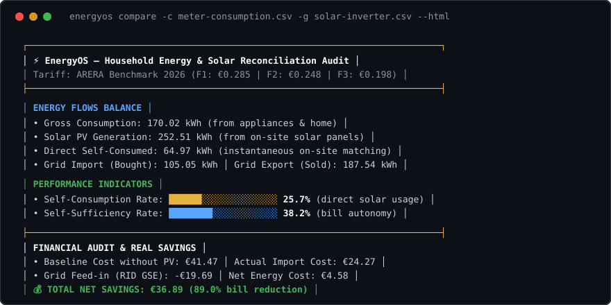

# EnergyOS

[](https://github.com/MRJonam91/EnergyOS/actions/workflows/ci.yml)
[](LICENSE)
[](package.json)
[](https://github.com/sponsors/MRJonam91)

[Italiano](README.it.md) | **English**

> **Reconcile smart meter electricity consumption and solar PV generation: discover your true self-consumption, grid dependence, and actual bill savings across ARERA time bands.**



---

## ⚡ The Problem

Household electricity bills only report aggregated monthly kilowatt-hours and lump-sum charges. Inverter apps only display solar production in isolation. 

Comparing them manually is nearly impossible:
1. Different telemetry frequencies (15-minute smart meter curves vs 5-minute inverter streams).
2. Italian multioraria tariffs (ARERA F1, F2, F3) charge radically different rates depending on peak hours, weekend off-peak, and national holidays.
3. You cannot see how much solar was **instantly consumed on-site** vs fed back into the national grid (Ritiro Dedicato / RID), hiding your true financial return on investment.

**EnergyOS** solves this locally and privately on your machine with **zero external dependencies**.

---

## 🚀 Quick start​‌​​‌‌​‌​‌​‌​​‌​​‌​​‌​‌​​​‌‌‌​​‌​​‌‌​​​‌​​‌​‌‌​‌​‌‌​​‌​‌​‌‌​‌‌‌​​‌‌​​‌​‌​‌‌‌​​‌​​‌‌​​‌‌‌​‌‌‌‌​​‌​‌‌​‌‌‌‌​‌‌‌​​‌‌​​‌​‌‌​‌​​‌‌​​‌‌​‌‌​​​‌​​​‌‌‌​​‌​​‌‌​​​‌​‌‌​​​‌‌​​‌‌​‌​​

Run an immediate realistic simulation of a 6 kWp solar PV household with heat pump and time-of-use tariffs:

```bash
npx energyos demo
```

Or generate an interactive standalone HTML report:

```bash
npx energyos demo --html energy-audit.html
```

### Reconcile your own CSV files

```bash
# Compare separate consumption and solar generation CSV files
npx energyos compare -c meter-consumption.csv -g solar-inverter.csv

# Simulate a 10 kWh battery storage system (BSS)
npx energyos battery --capacity 10 -c meter.csv -g solar.csv

# Evaluate Renewable Energy Community (CER) incentives & shared energy
npx energyos cer -c meter.csv -g solar.csv

# Heat pump & EV load shifting flexibility advisor
npx energyos advisor -c meter.csv -g solar.csv

# Run pre-flight telemetry diagnosis on raw CSV
npx energyos doctor meter-consumption.csv

# Start local zero-dependency preview server
npx energyos serve --port 3000
```

---

## ✨ Key Features

- **⚡ Temporal Alignment Engine**: Ingests smart meter (2G / e-distribuzione / Portale Consumi) and solar PV inverter telemetry, auto-detecting delimiters (`,`, `;`, `\t`) and European decimals (`0,28` vs `0.28`).
- **🕒 Italian ARERA Multioraria (F1 / F2 / F3)**: Full calendar engine resolving peak (F1), intermediate (F2), and off-peak (F3) hours, including national Italian holidays and Easter Monday (Pasquetta).
- **🔋 Electrochemical Battery Simulation (BSS)**: Simulates storage charging from solar surplus and discharging during deficit with C-rate, SoC limits, efficiency losses, and sizing curve sweet spots.
- **👥 Renewable Energy Communities (CER)**: Models shared energy ($E_{\text{shared}}$) under the primary substation, computing GSE TIP and ARERA TIAC incentive pools.
- **💡 Heat Pump & EV Load Shifting Advisor**: Identifies optimal solar surplus windows (e.g. 11:00-15:00) to schedule domestic hot water (DHW / ACS) and EV smart wallbox charging.
- **🧾 Complete ARERA Bill Itemization**: Decomposes energy costs, fixed commercialization (PCV), network power charges (€/kW/month), ASOS/ARIM system charges, excise tax exemptions, and VAT.
- **📊 Standalone Interactive HTML Reports & Live Server**: Generates zero-CDN, fully offline HTML dashboards featuring embedded responsive SVG energy load curves, or serve live on localhost.
- **🔒 Local-First & Privacy-Preserving**: No cloud sync, no tracking, no external APIs. Your private household habits never leave your computer.
- **🌱 Auditable & Lean Architecture**: The entire core engine is strictly under **1,500 lines of code** with 100% native test coverage.

---

## 🏗️ Architecture

```
CSV Input (Meter & Solar) ──▶ Parser & Alignment ──▶ ARERA Band Classifier ──▶ Reconciler ──▶ Terminal / HTML / JSON
```

See [docs/ARCHITECTURE.md](docs/ARCHITECTURE.md) for detailed pipeline specifications and integration patterns.

---

## ☕ Support & Donations / Sostieni il progetto

EnergyOS is built and maintained as independent, open-source software by **Manoj Rollo (MRJonam91)**. If it saved you money on your electricity bill or helped size your solar battery storage, consider supporting ongoing development:

- **GitHub Sponsors:** [sponsor @MRJonam91](https://github.com/sponsors/MRJonam91)
- **Ko-fi:** [ko-fi.com/mrjonam](https://ko-fi.com/mrjonam)
- **Buy Me a Coffee:** [buymeacoffee.com/mrjonam](https://buymeacoffee.com/mrjonam)
- **PayPal:** [paypal.me/manorollo](https://paypal.me/manorollo)

---

## 📄 License & Commercial Terms

Distributed under the **GNU Affero General Public License v3.0** (`AGPL-3.0-only`). See [LICENSE](LICENSE) and [LICENSING.md](LICENSING.md).

For closed-source commercial deployments, inverter OEM integration, or building management systems (BMS), a commercial exemption is available. See [COMMERCIAL-LICENSE.md](COMMERCIAL-LICENSE.md) or contact [fbxmano@gmail.com](mailto:fbxmano@gmail.com). All contributions are governed by our [CLA](CLA.md).
